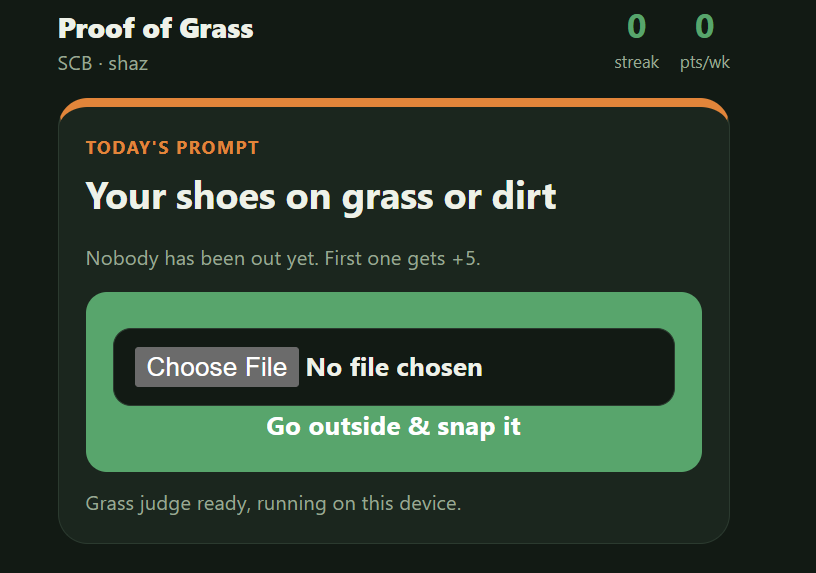

# 🌱 Proof of Grass

One photo a day. Taken outside. Judged by an open-weight AI.

Every day your friend group gets the same prompt ("a single fallen leaf", "your shadow", "water in the wild"). You go outside, snap it, and OpenAI's open-weight CLIP model, running on hardware you control, decides whether it counts. Pass and you earn points, keep your streak, and unlock your friends' photos, which stay blurred until you post.

The whole app is one Python file: `app.py`.

Here is a screenshot of today's challenge



## How the judge works

CLIP turns images and sentences into embeddings (lists of numbers) in the same space, so a photo of a leaf lands close to the sentence "a fallen leaf." Each photo gets two checks:

1. **Is it outside?** The photo is scored against outdoor scenes vs. indoor rooms, screens, and screenshots.
2. **Does it match today's prompt?** The photo is scored against the prompt plus five decoy prompts. The decoys are seeded by date, so every friend faces the same test.

Photos whose EXIF date isn't today are rejected, so you can't submit an old camera-roll picture.

**Scoring:** 10 points for a pass, plus up to 10 for how clearly it matches, plus 5 for being first out in your group that day.

Tune the judge with `OUTDOOR_THRESHOLD` and `MATCH_THRESHOLD` at the top of `app.py`.

## Limitations

- CLIP scores labels you give it; it doesn't describe images freely, so a determined cheater can fool it.
- The EXIF check is best-effort: webcam captures and some uploads have no date, and those are allowed.
- Anyone who knows a group code can join that group. Fine for friends, not for a public launch.

## [IGNORE] For Me: To Run it on my laptop 

```bash
pip install -r requirements.txt
python app.py
```

Open http://127.0.0.1:7860. The first run downloads the CLIP model (about 600 MB).

To use it from your phone, run `python app.py --share` instead. Gradio prints a temporary public HTTPS link. Your laptop has to stay on while people use it.

## Put it online for free (Hugging Face Spaces)

1. Create a new Space at huggingface.co/new-space and choose **Gradio**.
2. Upload `app.py`, `requirements.txt`, and this `README.md`.
3. Wait for it to build, then share the Space link and your group code with friends.

On a free Space, the saved photos and scores reset if the Space restarts. That's fine for a game day; turn on persistent storage if you want streaks to last weeks.

Set a `TIMEZONE` variable in the Space settings (for example `Africa/Nairobi`) so "today" matches your friend group's day. 

MIT licensed.
